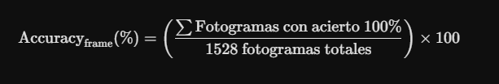
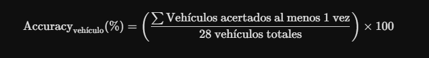
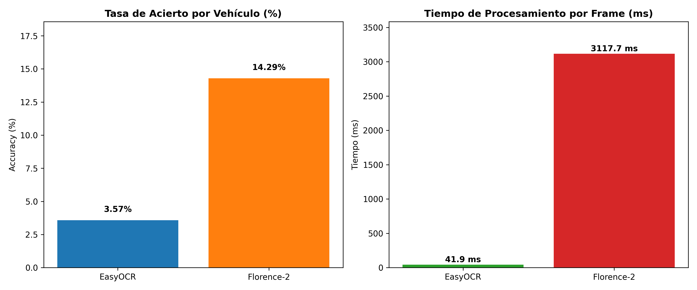

# README - PRÁCTICA 4 - VISIÓN POR COMPUTADOR: RECONOCIMIENTO Y SEGUIMIENTO DE VEHÍCULOS Y MATRÍCULAS (ANPR)

### Jaime Cuenca Relinque y Daniel Hernández Sánchez

#### **Objetivo del informe**

En este documento presentamos el resumen de la cuarta práctica de la asignatura, orientada a la detección de objetos, seguimiento multiobjeto en tiempo real (tracking) y reconocimiento óptico de caracteres (OCR) sobre matrículas de vehículos. 

Partiendo de los conocimientos de procesamiento y visión por computador, el propósito principal de esta práctica es integrar un pipeline compuesto por modelos de detección profunda (**YOLO**), algoritmos de asignación de identificadores de seguimiento en vídeo, y evaluar comparativamente dos aproximaciones de OCR (**EasyOCR** vs. **Florence-2**) sobre un conjunto de prueba anotado (*Ground Truth*).

---

### 2.1 - Tarea 1: Detección, Tracking de Vehículos y Localización de Matrículas en Vídeo

#### ¿Qué teníamos que conseguir?


---

### 2.2 - Tarea 2: Evaluación Comparativa de Motores OCR (EasyOCR vs. Florence-2)

#### ¿Qué teníamos que conseguir?

En esta segunda fase, el objetivo principal consistía en procesar las regiones recortadas de matrículas almacenadas en `resultados_deteccion.csv` y extraer la secuencia correspondiente comparando dos tecnologías distintas:

1. **OCR Tradicional**: Funciona mediante un flujo de procesamiento en dos fases independientes: Detección (CRAFT) y Reconocimiento (CRNN - ResNet + LSTM)

En nuestro caso se eligio EASYOCR

2. **Vision-Language Model (VLM)**: En este caso no divide la tarea en "detectar y luego leer". Utiliza una única red neuronal unificada que procesa visión y lenguaje humano al
mismo tiempo, guiada por un prompt textual.

En nuestro caso se eligio Florence-2

#### ¿Cómo lo hemos hecho?

Para llevar a cabo la comparativa se han desarrollado tres bloques clave:

##### 1. Lector de Matriculas con ambos OCR

Se implementó un script de procesamiento que lee los recortes de matrículas haciendo uso de resultados_deteccion.csv, gracias a la información de este csv se pueden analizar solo los frames donde hay presencia de matriculas, así como las coordenadas donde aplicar el OCR y guarda el mismo los datos de su predicción en resultados_finales_con_ocr el cual tiene un formato tal que:

```
cabecera = [
    "fotograma", "tiempo_segundos", "tipo_objeto", "confianza_yolo", "identificador_tracking", 
    "x1", "y1", "x2", "y2", "ocr_motor", "confianza_ocr", 
    "tiempo_procesamiento_ms", "mx1", "my1", "mx2", "my2", "texto_matricula"
]
```


**EasyOCR**: Se evalúa la imagen recortada mediante `lector_easyocr.readtext()`, registrando el texto extraído y su nivel de confianza asignado.

**Florence-2**: La imagen recortada se convierte a formato RGB (`PIL.Image`) y se procesa mediante el *Vision Transformer* utilizando el prompt especial `<OCR>`. Se genera la decodificación autorregresiva con `model.generate(..., num_beams=3)` y se mide el tiempo consumido en milisegundos.

##### 2. Creación de Datos reales

Por otro lado, para poder realizar la comparativa se ha de saber los datos reales que tienen las matrículas y no solo los que se han predecido. Por ello se ha creado un csv con la siguiente estructura:

```
df_unicos.columns = [
    'identificador_tracking', 
    'frame_inicio', 
    'frame_fin', 
    'tiempo_inicio_seg', 
    'tiempo_fin_seg', 
    'tipo_objeto',
    'matricula_real',
    'es_falso_positivo'
]
```

El mismo será creado utilizando los datos que ya se han obtenido en resultados_deteccion.csv pero en este caso dejando el numero de matricula vacio para rellenarlo posteriormente viendo el video. 

Gracias a este formato nos he posible realizar una métricas de manera mucho mas sencilla al tener tanto el identificador del tracker como los frames en los que aparece y desaparece la matrícula.

##### 3. Cálculo de Métricas

Por ultimo, con la ayuda de gemini se han creado métricas para evaluar el rendimiento de los OCR. Las metricas que se analizan son:

**Accuracy a nivel de fotograma (Frame-level)**:



**Accuracy a nivel de vehículo (Vehicle-level)**:



**Distancia de Levenshtein media**: Es un algoritmo matemático que mide la distancia de edición entre dos cadenas de texto. Indica cuántos cambios simples (insertar, borrar o sustituir un carácter) hacen falta para transformar la lectura del OCR en la matrícula real.

**Tiempo medio de procesamiento (ms)**: El tiempo exacto que tarda cada motor en procesar un recorte de matrícula.


Para una comparativa homogénea, todos los resultados predichos y reales se sometieron a una función de normalización

Ejemplo práctico Levenshtein: Para pasar de 1770JIG (predicción) a 1770JYG (real), basta con sustituir la 'I' por la 'Y'. Distancia = 1

---

#### ¿Qué resultados hemos obtenido?

Con estas métricas creadas ya podemos visualizar y comentar los resultados que se han obtenido

A continuación se resumen los resultados numéricos globales obtenidos tras procesar un total de **1.528 fotogramas con detección de matrícula** distribuidos entre **28 vehículos únicos**:

##### Métricas a nivel de fotograma (Frame-Level)

| Motor OCR | Total Frames | Aciertos Exactos | Accuracy Frame (%) | Levenshtein Medio | Tiempo Medio (ms) |
| :--- | :---: | :---: | :---: | :---: | :---: |
| **EasyOCR** | 1528 | 7 | **0.46%** | 6.77 | **41.92 ms** |
| **Florence-2** | 1528 | 44 | **2.88%** | **5.91** | 3117.67 ms |

##### Métricas a nivel de vehículo (Vehicle-Level)

| Motor OCR | Vehículos Totales | Vehículos Acertados ($\ge 1$) | Accuracy Vehículo (%) | Levenshtein Mín. Medio |
| :--- | :---: | :---: | :---: | :---: |
| **EasyOCR** | 28 | 1 | **3.57%** | 5.57 |
| **Florence-2** | 28 | 4 | **14.29%** | **3.32** |

##### Gráficas



---

##### Desglose detallado por vehículo en la secuencia (`tabla_desglosada_vehiculos.csv`)

En la siguiente tabla se detalla el comportamiento de ambos motores sobre la mejor lectura registrada para cada identificador de vehículo único:

| ID | Matrícula Real | Mejor Lectura EasyOCR | Levenshtein EasyOCR | Acierto EasyOCR | Mejor Lectura Florence-2 | Levenshtein Florence-2 | Acierto Florence-2 |
| :---: | :---: | :---: | :---: | :---: | :---: | :---: | :---: |
| **1** | `3326HZC` | *SIN_TEXTO* | 7 | NO | `W726` | 5 | NO |
| **8** | `1902HBC` | *SIN_TEXTO* | 7 | NO | `127` | 5 | NO |
| **13** | `5744GGP` | *SIN_TEXTO* | 7 | NO | `5765` | 5 | NO |
| **14** | `3713LKC` | `DTL` | 6 | NO | **`3713LKC`** | **0** | **SÍ** |
| **15** | `4931KSZ` | *SIN_TEXTO* | 7 | NO | `1` | 6 | NO |
| **19** | `0848MCG` | `MRA` | 6 | NO | `0848VGC` | 3 | NO |
| **21** | `3324HMS` | *SIN_TEXTO* | 7 | NO | `M` | 6 | NO |
| **22** | `6713HCR` | *SIN_TEXTO* | 7 | NO | `6713H2` | 2 | NO |
| **25** | `1624LKZ` | *SIN_TEXTO* | 7 | NO | `1` | 6 | NO |
| **27** | `2914FGN` | *SIN_TEXTO* | 7 | NO | `2916FGN` | 1 | NO |
| **31** | `9786LCF` | `MC` | 6 | NO | `6786LCS` | 2 | NO |
| **36** | `0053JFM` | `0053` | 3 | NO | `OSSJFV` | 5 | NO |
| **38** | `0216HZK` | *SIN_TEXTO* | 7 | NO | `1216` | 4 | NO |
| **39** | `3902FXD` | `32F` | 4 | NO | `3252F10` | 4 | NO |
| **42** | `0285FKZ` | `0285117` | 3 | NO | **`0285FKZ`** | **0** | **SÍ** |
| **48** | `3685KWM` | `3685` | 3 | NO | `3685KOV` | 2 | NO |
| **50** | `9059LYY` | *SIN_TEXTO* | 7 | NO | `1339LY` | 4 | NO |
| **55** | `8536LKJ` | `8526` | 4 | NO | `8526LKJ` | 1 | NO |
| **61** | `6023JBO` | *SIN_TEXTO* | 7 | NO | `25` | 6 | NO |
| **62** | `5695LTR` | `DELA` | 6 | NO | `ES65LTR` | 3 | NO |
| **69** | `1770JYG` | `1770JIG` | 1 | NO | **`1770JYG`** | **0** | **SÍ** |
| **72** | `7339LGG` | *SIN_TEXTO* | 7 | NO | `7359L6` | 3 | NO |
| **73** | `8098JXM` | `8028JX` | 2 | NO | `8098JXV` | 1 | NO |
| **75** | `1965KBP` | **`1965KBP`** | **0** | **SÍ** | **`1965KBP`** | **0** | **SÍ** |
| **76** | `GC5273CM` | *SIN_TEXTO* | 8 | NO | `85736` | 5 | NO |
| **77** | `5143LCY` | `15TT61` | 6 | NO | `SISLEY` | 5 | NO |
| **80** | `9733KFV` | *SIN_TEXTO* | 7 | NO | `SKIN` | 6 | NO |
| **83** | `5017HDD` | *SIN_TEXTO* | 7 | NO | `5017` | 3 | NO |

---

##### Conclusiones y Análisis Técnico

Por último al haber visualizado todos estos datos se sacan las siguiente conclusiones:

Por un lado, el modelo VLM **Florence-2** supera de forma significativa a EasyOCR en porcentaje de acierto alcanzando un **14.29% de acierto**  por vehiculo frente a un **3.57%**. Ademas de una distancia media de Levenshtein mas baja.

Por otro, el **costo computacional** es inverso, EasyOCR destaca por su extrema velocidad en CPU (**41.92 ms por fotograma**), permitiendo su ejecución fluida en tiempo real. Por su parte, Florence-2 requiere aproximadamente **3.12 segundos por recorte en CPU**, lo que sugiere la necesidad de aceleración por GPU o un esquema de muestreo por fotogramas.

Por último, la baja exactitud global a nivel de fotograma ($2.88\%$) se debe a factores del vídeo de origen: desenfoque por movimiento, bajas resoluciones en vehículos lejanos y variaciones bruscas de iluminación que dificultan la lectura exacta de los 7 caracteres en un único frame.
