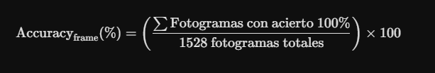
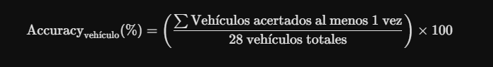
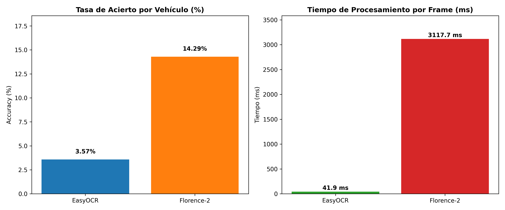

# README - PRÁCTICA 4 - VISIÓN POR COMPUTADOR: RECONOCIMIENTO Y SEGUIMIENTO DE VEHÍCULOS Y MATRÍCULAS 

### Jaime Cuenca Relinque y Daniel Hernández Sánchez

Debido a las limitaciones de tamaño de almacenamiento estándar de GitHub (25 MB por archivo en subida directa y 100 MB mediante Git), todos los recursos de gran volumen generados durante el desarrollo de la práctica se encuentran alojados y disponibles para su descarga directa en la sección de Releases del repositorio [https://github.com/jaimecuenca2004/VC_P4/releases]
#### **Objetivo del informe**

Esta práctica se compone de dos tareas diferenciadas: la detección de objetos y el posterior reconocimiento óptico de caracteres (OCR). Ambas partes del trabajo se entregarán de forma conjunta en el repositorio principal de GitHub para su evaluación.

Para llevar a cabo el desarrollo, construimos un entorno de trabajo funcional basado en Python 3.9.5 bajo el environment de Anaconda denominado VC_P4. En este entorno hemos integrado librerías clave de procesamiento de imagen e inteligencia artificial, destacando:

**ultralytics**: Para la carga e inferencia de los modelos YOLO y RT-DETR.

**opencv-python (cv2)**: Como motor principal de manipulación de vídeo, lectura de fotogramas, dibujado de ROI y operaciones geométricas.

**numpy**: Para el tratamiento matricial de máscaras, contornos y transformaciones.

**Módulos (csv, math, time)**: Para la gestión de registros, cálculos métricos y monitorización de rendimiento en milisegundos.

### 2.1 - Tarea 1: Detección, Tracking de Vehículos y Localización de Matrículas en Vídeo

#### 2.1.1 Aspectos cubiertos

**¿Qué teníamos que hacer?**  
Desarrollar un prototipo de visión por computador capaz de procesar vídeo continuo, realizar el seguimiento temporal de vehículos y peatones asignándoles un identificador único persistente, y localizar las matrículas presentes en la escena.

**¿Cómo lo hemos afrontado?**  
Dado que el dataset que teníamos no era muy eficaz, optamos por diseñar el código en 2 etapas para un mejor reconocimiento de las matrículas. Tanto las personas como los vehículos ya están entrenados y detectados al importar YOLO. Las 2 etapas son:

1. **Detección general y seguimiento:** Usamos un detector multiclase global (YOLO) junto con algoritmos para mantener la identidad de cada objeto.
   
2. **Detección focalizada en matrículas (ROI):** Para optimizar recursos y reducir falsos positivos, la búsqueda de matrículas no se lanza sobre toda la imagen global, sino sobre una región de interés (ROI) que se amplía sobre los vehículos que detecte YOLO.
   

**Resultados obtenidos:**  
Logramos un procesamiento del vídeo de prueba (C0142.MP4), debido al uso de CPU limitada, el vídeo no se reproduce con fluidez, aunque sí se pueden distinguir perfectamente tanto los vehículos y personas como la mayoría de matrículas.


### 2.1.2 Entrenamiento de YOLO

**¿Qué teníamos que hacer?**  
Dado que los modelos generales preentrenados no detectan matrículas, era indispensable entrenar un detector personalizado con un conjunto de datos especializado.

**¿Cómo lo hemos afrontado?**  
Utilizamos un conjunto de datos fotografiado y anotado por nosotros, compuesto por imágenes reales de coches y motos con sus correspondientes etiquetas rectangulares en el formato normalizado de YOLO(`<class> <x> <y> <width> <height>`). 

Debido a la alta exigencia computacional del entrenamiento, todo el proceso se realizó externamente en Google Colab con aceleración por GPU durante 40 épocas. Por esta razón, el proceso pesado no satura el cuaderno local del repositorio y únicamente se importan los pesos finales optimizados junto con las gráficas para evaluar la tasa de acierto respecto al dataset (best.pt).

**Resultados obtenidos:**  
Obtuvimos un detector de matrículas eficiente. En la evaluación sobre el vídeo de test, el modelo detecta la mayoría de las matrículas visibles. En caso de que en algún fotograma aislado una matrícula no sea registrada por inclinación o sombras, nuestro sistema de memoria persistente compensa la ausencia manteniendo la caja delimitadora en pantalla durante 4 fotogramas para evitar el parpadeo en la detección.

En cuanto al entrenamiento de YOLO durante 40 épocas muestra una convergencia sólida y sin signos de sobreajuste, como refleja el descenso constante y paralelo de las funciones de pérdida (loss) tanto en entrenamiento como en validación. En cuanto a las métricas de rendimiento, tras las primeras 10 épocas de ajuste, la precisión se estabiliza en torno al 95% - 96% y el recall  supera el 94%-96%, lo que garantiza una detección casi total de las placas reales con un margen mínimo de falsos positivos y negativos

El entrenamiento de este modelo (RT-DETR) sobre el conjunto de datos de matrículas durante 40 épocas tiene una convergencia muy rápida, estable y libre de sobreajuste, como muestra el descenso progresivo de las funciones de pérdida y su posterior estabilización en los valores mínimos de validación a partir de la época 10. En las gráficas de rendimiento (metrics), tras los ajustes iniciales de las primeras iteraciones, tanto la precisión como el recall  se consolidan de forma constante por encima del 93%-96%, lo que demuestra una capacidad sobresaliente para localizar prácticamente todas las matrículas reales sin generar falsos positivos.

<p align="center">
  
  <br>
  <em>Figura 1: Parámetros de entrenamiento en Google Colab.</em>
</p>

<p align="center">
  
  <br>
  <em>Figura 2: Gráficas de evolución de pérdidas y métricas de precisión/recall en entrenamiento YOLO.</em>
</p>

<p align="center">
  
  <br>
  <em>Figura 3: Gráficas de evolución de pérdidas y métricas de precisión/recall en entrenamiento RT-DETR.</em>
</p>

#### 2.1.3 RT-DETR

**¿Qué teníamos que hacer?**  
Explorar modelos alternativos a YOLO, evaluando la arquitectura RT-DETR(Real-Time Detection Transformer).

**¿Cómo lo hemos afrontado?**  
Instalamos las librerías tensorboard y faster_coco_eval, y entrenamos el modelo bestRTDER.pt en Google Colab utilizando el mismo dataset de matrículas. En la Celda 5 de código desarrollamos un análisis comparativo secuencial que procesa cada ROI de vehículo en paralelo con ambos modelos, midiendo sus tiempos de inferencia en milisegundos mediante la librería time.

**Resultados obtenidos:**  
Comprobamos que RT-DETR demuestra una precisión en encuadres complejos y lejanos gracias al mecanismo de atención de su arquitectura Transformer, mientras que YOLO ofrece tiempos de respuesta por ROI más reducidos, ideales para procesamiento en tiempo real.

#### 2.1.4 Entrega y Desarrollo por Celdas

A continuación se detalla cómo afrontamos y qué resultados obtuvimos en cada una de las celdas de código del proyecto, cumpliendo los requisitos obligatorios y los cuatro extras propuestos:

##### Celda 1: Prototipo Base de Detección en ROI y Memoria Persistente

**¿Qué teníamos que hacer?** En esta primera celda construimos el núcleo de detección de matrículas en vehículos evitando falsos positivos y parpadeos en pantalla. En esta primera celda solo evaluamos la detección de matrículas para asegurarnos de que los pesos que hemos entrenado detectan bien las matrículas.

**¿Cómo lo hemos afrontado?** Dado que solo con la red no llegaba a detectar del todo las matrículas decidimos ampliar el código de detección utilizando lo siguiente: Definimos una Región de Interés (ROI) con un 20% de margen sobre cada vehículo. Aplicamos filtros de relación de aspecto (ancho/alto) y de posición vertical para descartar falsos positivos (como los logotipos de marcas en la parte frontal). Además, programamos un diccionario de memoria persistente (plate_memory) que retiene la ubicación de la matrícula durante 4 fotogramas (MAX_PERSIST_FRAMES = 4) si la red pierde la detección momentáneamente.

**Resultados obtenidos:** Visualización fluida y libre de parpadeos con las matrículas marcadas en verde fosforito. Como podemos ver detecta una gran parte de las matrículas y detecta prácticamente todas las personas y vehículos a excepción de vehículos que están tapados por otros vehículos, objetos o están muy lejos para ser detectados.

##### Celda 2: Generación de Vídeo, Registro CSV y Panel de Conteo

**¿Qué teníamos que hacer?** En este apartado juntamos todos los requisitos necesarios para realizar la práctica. Se produce tanto la detección de vehículos, personas y matrículas, como el proceso de exportar la prueba a disco, registrar un archivo CSV con toda la información técnica por fotograma y mostrar un panel de recuento acumulado de cada clase del vídeo.

**¿Cómo lo hemos afrontado?** Escalamos el modelo base a yolo11s.pt e integramos cv2.VideoWriter para volcar el vídeo resultado_procesado.mp4. Con csv.writer estructuramos el archivo resultados_deteccion.csv guardando fotograma, tipo de objeto, confianza, ID de tracking, coordenadas `(x_1, y_1, x_2, y_2)`, presencia de matrícula, datos de la placa. Diseñamos también un panel superior con contadores acumulados de clases y matrículas únicas.

**Resultados obtenidos:** Obtenemos una exportación exitosa de los entregables requeridos en disco y un resumen final impreso cuando termina el vídeo. Los resultados son 27 personas, 3 motocicletas, 1 autobús y 1 bicicleta. También halló 38 coches, sin embargo, contó como duplicados coches que desaparecía su ROI y volvía a reactivarse después con otro ID distinto. Además, el modelo localizó 28 matrículas únicas de los aproximadamente 31 vehículos con matrícula (no contamos bicicletas) en escena. Este porcentaje del 91% es un resultado excelente para una grabación real, ya que captura prácticamente todos los vehículos que van de frente o con matrícula legible. Los coches parados no los detecta 2 veces gracias a que hemos puesto un mínimo de cambio en el área del rectángulo.

<p align="center">
  
  <br>
  <em>Figura 4: Detección de matrículas en coches tras el entrenamiento.</em>
</p>

<p align="center">
  
  <br>
  <em>Figura 5: Detección de personas y matrículas en coches simultáneamente tras el entrenamiento.</em>
</p>

##### Celda 3: Estimación de Flujo y Anonimización por Desenfoque

**¿Qué teníamos que hacer?** Clasificar la dirección del movimiento de vehículos y personas (si se acercan o se alejan) y aplicar un filtro de anonimización tanto a matrículas de los vehículos como a personas.

**¿Cómo lo hemos afrontado?** Analizamos el desplazamiento del centro vertical (Delta cy) y la variación del área del objeto a lo largo de un historial de 40 fotogramas continuos para determinar el sentido de marcha (filtrando vehículos parados). Para la anonimización, creamos la función blur_roi con un desenfoque gaussiano (cv2.GaussianBlur) sobre personas y matrículas. Si un coche no presenta la matrícula clara, se desenfoca de forma preventiva la caja general.

**Resultados obtenidos:** Se ha producido la generación del vídeo resultado_anonimizado.mp4 y reporte en la pantalla del recuento de trayectorias. Obtiene un resultado excelente, pues consigue perfectamente tanto la anonimización como el seguimiento de las personas y de los vehículos. Se consigue un total de 18 coches que se alejan y 16 que se acercan. También se observan 10 personas que se alejan y 2 que se acercan.

<p align="center">
  
  <br>
  <em>Figura 6: Anonimización de personas y coche dado que no detecta bien la matrícula.</em>
</p>

<p align="center">
  
  <br>
  <em>Figura 7: Anonimización de personas y matrícula dado que sí detecta bien la matrícula.</em>
</p>>


##### Celda 4: Detección de Matrículas por Contornos Tradicionales

**¿Qué teníamos que hacer?** Probar una técnica de visión por computador clásica sin utilizar redes neuronales secundarias para localizar matrículas.

**¿Cómo lo hemos afrontado?** Implementamos la función detect_plate_contours, que convierte la ROI a escala de grises, aplica un filtro bilateral, extrae bordes con Canny y filtra contornos de 4 vértices (cv2.approxPolyDP) que cumplan las proporciones geométricas de una placa.
**Resultados obtenidos:** Aunque el vídeo se reproduce con mayor fluidez, el resultado es nefasto, pues detecta muchísimos falsos positivos al confundir objetos rectangulares (ventanas o partes de los coches) con matrículas.

<p align="center">
  
  <br>
  <em>Figura 8: Falsos positivos generados por el método de contornos al confundir elementos rectangulares del vehículo con placas.</em>
</p>

<p align="center">
  
  <br>
  <em>Figura 9: Ejemplo de detección correcta de matrícula mediante visión artificial clásica.</em>
</p>


##### Celda 5: Comparativa Directa YOLO vs. RT-DETR

**¿Qué teníamos que hacer?** Comparar el rendimiento y velocidad entre YOLO y RT-DETR utilizando los pesos entrenados previamente en Colab best.pt y bestRTDER.pt respectivamente.

**¿Cómo lo hemos afrontado?** Evaluamos ambas redes secuencialmente sobre las mismas ROIs, midiendo el tiempo de inferencia en milisegundos con time.time(). Dibujamos las detecciones de YOLO en verde y las de RT-DETR en amarillo, y exportamos las métricas en el archivo comparativa_yolo_vs_rtdetr.csv.

**Resultados obtenidos:** Tras ver la imagen proporcionada con los resultados obtenidos, podemos concluir los siguientes aspectos:

**Eficiencia Computacional y Latencia:** La diferencia en el tiempo de inferencia es determinante. YOLO procesa cada ROI en un promedio de 69.79 ms, resultando 11.66 veces más rápido que RT-DETR, el cual requiere 813.61 ms. En la ejecución completa de la prueba, RT-DETR consumió aproximadamente el 86% del tiempo total de cómputo.

**Capacidad de Detección:** En términos de sensibilidad (recall), ambos modelos ofrecen un rendimiento prácticamente idéntico. RT-DETR logra identificar únicamente una matrícula adicional respecto a YOLO (29 frente a 28, lo que supone una diferencia marginal del 3.57%).Además RTDER  produce menos parpadeo en el seguimiento de las matrículas

<p align="center">
  
  <br>
  <em>Figura 10: Resultados de detección y localización de matrículas con el modelo YOLO y RTDER.</em>
</p>>

<p align="center">
  
  <br>
  <em>Figura 11: Métricas de comparación entre YOLO y RTDER.</em>
</p>

### 2.2 - Tarea 2: Evaluación Comparativa de Motores OCR (EasyOCR vs. Florence-2)

#### ¿Qué teníamos que conseguir?

En esta segunda fase, el objetivo principal consistía en procesar las regiones recortadas de matrículas almacenadas en `resultados_deteccion.csv` y extraer la secuencia correspondiente comparando dos tecnologías distintas:

1. **OCR Tradicional**: Funciona mediante un flujo de procesamiento en dos fases independientes: Detección (CRAFT) y Reconocimiento (CRNN - ResNet + LSTM)

En nuestro caso se eligió EASYOCR

2. **Vision-Language Model (VLM)**: En este caso no divide la tarea en "detectar y luego leer". Utiliza una única red neuronal unificada que procesa visión y lenguaje humano al
mismo tiempo, guiada por un prompt textual.

En nuestro caso se eligio Florence-2

#### ¿Cómo lo hemos hecho?

Para llevar a cabo la comparativa se han desarrollado tres bloques clave:

##### 1. Lector de Matrículas con ambos OCR

Se implementó un script de procesamiento que lee los recortes de matrículas haciendo uso de resultados_deteccion.csv, gracias a la información de este csv se pueden analizar solo los frames donde hay presencia de matriculas, así como las coordenadas donde aplicar el OCR y guarda el mismo los datos de su predicción en resultados_finales_con_ocr el cual tiene un formato tal que:

```
cabecera = [
    "fotograma", "tiempo_segundos", "tipo_objeto", "confianza_yolo", "identificador_tracking", 
    "x1", "y1", "x2", "y2", "ocr_motor", "confianza_ocr", 
    "tiempo_procesamiento_ms", "mx1", "my1", "mx2", "my2", "texto_matricula"
]
```


**EasyOCR**: Se evalúa la imagen recortada mediante `lector_easyocr.readtext()`, registrando el texto extraído y su nivel de confianza asignado.

**Florence-2**: La imagen recortada se convierte a formato RGB (`PIL.Image`) y se procesa mediante el *Vision Transformer* utilizando el prompt especial `<OCR>`. Se genera la decodificación autorregresiva con `model.generate(..., num_beams=3)` y se mide el tiempo consumido en milisegundos.

##### 2. Creación de Datos reales

Por otro lado, para poder realizar la comparativa se ha de saber los datos reales que tienen las matrículas y no solo los que se han predecido. Por ello se ha creado un csv con la siguiente estructura:

```
df_unicos.columns = [
    'identificador_tracking', 
    'frame_inicio', 
    'frame_fin', 
    'tiempo_inicio_seg', 
    'tiempo_fin_seg', 
    'tipo_objeto',
    'matricula_real',
    'es_falso_positivo'
]
```

El mismo será creado utilizando los datos que ya se han obtenido en resultados_deteccion.csv pero en este caso dejando el numero de matricula vacio para rellenarlo posteriormente viendo el video. 

Gracias a este formato nos es posible realizar una métricas de manera mucho mas sencilla al tener tanto el identificador del tracker como los frames en los que aparece y desaparece la matrícula.

##### 3. Cálculo de Métricas

Por último, con la ayuda de Gemini se implementaron las métricas de evaluación para evaluar el rendimiento de los OCR. Las métricas que se analizan son:

**Accuracy a nivel de fotograma (Frame-level)**:



**Accuracy a nivel de vehículo (Vehicle-level)**:



**Distancia de Levenshtein media**: Es un algoritmo matemático que mide la distancia de edición entre dos cadenas de texto. Indica cuántos cambios simples (insertar, borrar o sustituir un carácter) hacen falta para transformar la lectura del OCR en la matrícula real.

**Tiempo medio de procesamiento (ms)**: El tiempo exacto que tarda cada motor en procesar un recorte de matrícula.


Para una comparativa homogénea, todos los resultados predichos y reales se sometieron a una función de normalización

Ejemplo práctico Levenshtein: Para pasar de 1770JIG (predicción) a 1770JYG (real), basta con sustituir la 'I' por la 'Y'. Distancia = 1

---

#### ¿Qué resultados hemos obtenido?

Con estas métricas creadas ya podemos visualizar y comentar los resultados que se han obtenido

A continuación se resumen los resultados numéricos globales obtenidos tras procesar un total de **1.528 fotogramas con detección de matrícula** distribuidos entre **28 vehículos únicos**:

##### Métricas a nivel de fotograma (Frame-Level)

| Motor OCR | Total Frames | Aciertos Exactos | Accuracy Frame (%) | Levenshtein Medio | Tiempo Medio (ms) |
| :--- | :---: | :---: | :---: | :---: | :---: |
| **EasyOCR** | 1528 | 7 | **0.46%** | 6.77 | **41.92 ms** |
| **Florence-2** | 1528 | 44 | **2.88%** | **5.91** | 3117.67 ms |

##### Métricas a nivel de vehículo (Vehicle-Level)

| Motor OCR | Vehículos Totales | Vehículos Acertados ($\ge 1$) | Accuracy Vehículo (%) | Levenshtein Mín. Medio |
| :--- | :---: | :---: | :---: | :---: |
| **EasyOCR** | 28 | 1 | **3.57%** | 5.57 |
| **Florence-2** | 28 | 4 | **14.29%** | **3.32** |

##### Gráficas



---

##### Desglose detallado por vehículo en la secuencia (`tabla_desglosada_vehiculos.csv`)

En la siguiente tabla se detalla el comportamiento de ambos motores sobre la mejor lectura registrada para cada identificador de vehículo único:

| ID | Matrícula Real | Mejor Lectura EasyOCR | Levenshtein EasyOCR | Acierto EasyOCR | Mejor Lectura Florence-2 | Levenshtein Florence-2 | Acierto Florence-2 |
| :---: | :---: | :---: | :---: | :---: | :---: | :---: | :---: |
| **1** | `3326HZC` | *SIN_TEXTO* | 7 | NO | `W726` | 5 | NO |
| **8** | `1902HBC` | *SIN_TEXTO* | 7 | NO | `127` | 5 | NO |
| **13** | `5744GGP` | *SIN_TEXTO* | 7 | NO | `5765` | 5 | NO |
| **14** | `3713LKC` | `DTL` | 6 | NO | **`3713LKC`** | **0** | **SÍ** |
| **15** | `4931KSZ` | *SIN_TEXTO* | 7 | NO | `1` | 6 | NO |
| **19** | `0848MCG` | `MRA` | 6 | NO | `0848VGC` | 3 | NO |
| **21** | `3324HMS` | *SIN_TEXTO* | 7 | NO | `M` | 6 | NO |
| **22** | `6713HCR` | *SIN_TEXTO* | 7 | NO | `6713H2` | 2 | NO |
| **25** | `1624LKZ` | *SIN_TEXTO* | 7 | NO | `1` | 6 | NO |
| **27** | `2914FGN` | *SIN_TEXTO* | 7 | NO | `2916FGN` | 1 | NO |
| **31** | `9786LCF` | `MC` | 6 | NO | `6786LCS` | 2 | NO |
| **36** | `0053JFM` | `0053` | 3 | NO | `OSSJFV` | 5 | NO |
| **38** | `0216HZK` | *SIN_TEXTO* | 7 | NO | `1216` | 4 | NO |
| **39** | `3902FXD` | `32F` | 4 | NO | `3252F10` | 4 | NO |
| **42** | `0285FKZ` | `0285117` | 3 | NO | **`0285FKZ`** | **0** | **SÍ** |
| **48** | `3685KWM` | `3685` | 3 | NO | `3685KOV` | 2 | NO |
| **50** | `9059LYY` | *SIN_TEXTO* | 7 | NO | `1339LY` | 4 | NO |
| **55** | `8536LKJ` | `8526` | 4 | NO | `8526LKJ` | 1 | NO |
| **61** | `6023JBO` | *SIN_TEXTO* | 7 | NO | `25` | 6 | NO |
| **62** | `5695LTR` | `DELA` | 6 | NO | `ES65LTR` | 3 | NO |
| **69** | `1770JYG` | `1770JIG` | 1 | NO | **`1770JYG`** | **0** | **SÍ** |
| **72** | `7339LGG` | *SIN_TEXTO* | 7 | NO | `7359L6` | 3 | NO |
| **73** | `8098JXM` | `8028JX` | 2 | NO | `8098JXV` | 1 | NO |
| **75** | `1965KBP` | **`1965KBP`** | **0** | **SÍ** | **`1965KBP`** | **0** | **SÍ** |
| **76** | `GC5273CM` | *SIN_TEXTO* | 8 | NO | `85736` | 5 | NO |
| **77** | `5143LCY` | `15TT61` | 6 | NO | `SISLEY` | 5 | NO |
| **80** | `9733KFV` | *SIN_TEXTO* | 7 | NO | `SKIN` | 6 | NO |
| **83** | `5017HDD` | *SIN_TEXTO* | 7 | NO | `5017` | 3 | NO |

---

##### Conclusiones y Análisis Técnico

Por último al haber visualizado todos estos datos se extraen las siguiente conclusiones:

Por un lado, el modelo VLM **Florence-2** supera de forma significativa a EasyOCR en porcentaje de acierto alcanzando un **14.29% de acierto**  por vehí
culo frente a un **3.57%**. Ademas de una distancia media de Levenshtein mas baja.

Por otro, el **costo computacional** es inverso, EasyOCR destaca por su extrema velocidad en CPU (**41.92 ms por fotograma**), permitiendo su ejecución fluida en tiempo real. Por su parte, Florence-2 requiere aproximadamente **3.12 segundos por recorte en CPU**, lo que sugiere la necesidad de aceleración por GPU o un esquema de muestreo por fotogramas.

Por último, la baja exactitud global a nivel de fotograma ($2.88\%$) se debe a factores del vídeo de origen: desenfoque por movimiento, bajas resoluciones en vehículos lejanos y variaciones bruscas de iluminación que dificultan la lectura exacta de los 7 caracteres en un único frame.

**[👉 Haz clic aquí para ver el vídeo de demostración con OCR en vivo](https://drive.google.com/file/d/18xE46Sx48md9swRfizW-XkhBqPDpDdrl/view?usp=drive_link)**

##### Especificaciones del PC

* **Procesador (CPU):** [Intel(R) Core(TM) i7-6700K CPU @ 4.00GHz]
* **Memoria RAM:** [16 GB]
* **Sistema Operativo:** [Windows 10 Enterprise de 64 bits]
* **Entorno de ejecución:** 100% CPU (sin uso de CUDA/GPU).
